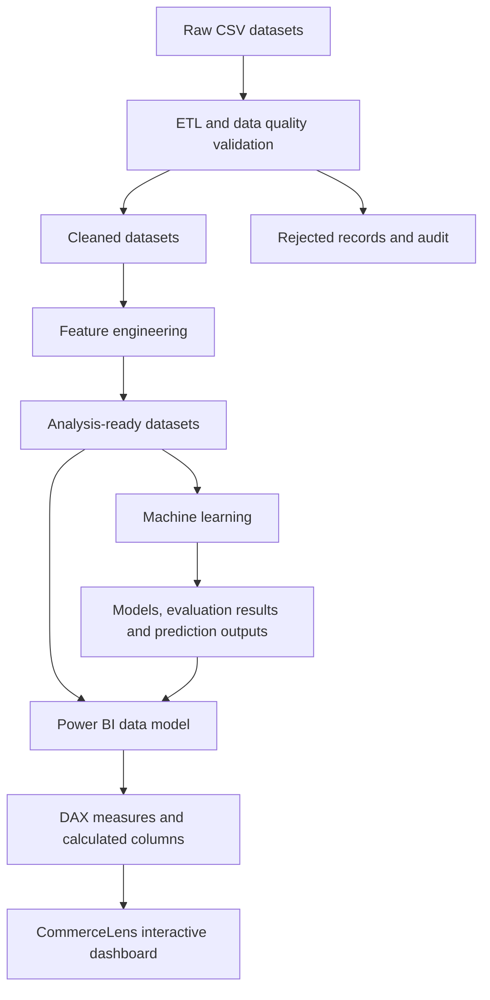

# CommerceLens

### E-Commerce Analytics & Predictive Modeling

*From Data to Decisions.*

**Python · Pandas · NumPy · Scikit-learn · LightGBM · XGBoost · Power BI · DAX · Power Query**

[Overview](#project-overview) · [Architecture](#project-architecture) · [Repository](#repository-structure) · [Model results](#predictive-modeling) · [Dashboard](#power-bi-dashboard) · [Getting started](#getting-started)

---

## Project Overview

CommerceLens is an end-to-end e-commerce analytics project that transforms transactional, customer and product data into interactive business reports and machine learning insights. It combines Python-based data preparation, predictive modeling, a relational Power BI data model and DAX calculations in a single analytical workflow.

The project focuses on sales and profitability, customer purchasing behavior, product performance, marketing contribution, delivery efficiency and product returns. Three machine learning workflows extend historical reporting with return-risk identification, daily sales forecasting and customer segmentation.

| Dataset / deliverable | Scope |
| :--- | ---: |
| Historical period | 2021–2025 |
| Orders | 138,116 |
| Order-item records | 365,978 |
| Customer master records (source) | 25,000 |
| Product catalog records (source) | 1,175 |
| Machine learning workflows | 3 |
| Power BI report pages | 11 |

## Project Architecture



## Repository Structure

```text
CommerceLens/
├── README.md
├── .gitignore
├── 1. Documents/
│   ├── Proj Overview.pdf
│   ├── Folder Arch.txt
│   ├── Proj Arch.jpeg
│   └── my_ecom.docx
├── 2. Data/
│   ├── 1. Raw/
│   │   ├── ecommerce_sales_customer_analytics_150k.csv
│   │   ├── order_items.csv
│   │   ├── customer_master.csv
│   │   ├── product_catalog.csv
│   │   └── dataset_statistics.csv
│   ├── 2. Cleaned/
│   │   ├── sales_cln.csv
│   │   ├── orders_cln.csv
│   │   ├── customers_cln.csv
│   │   ├── products_cln.csv
│   │   └── dataset_statistics.csv
│   ├── 3. Deleted/
│   │   ├── sales_rejected.csv
│   │   ├── orders_rejected.csv
│   │   ├── customers_rejected.csv
│   │   └── products_rejected.csv
│   ├── 4. Feature Engineering/
│   │   ├── sales.csv
│   │   ├── orders.csv
│   │   ├── customers.csv
│   │   ├── products.csv
│   │   └── dataset_statistics.csv
│   └── Scripts/
│       ├── ETL.py
│       ├── my_analysis.py
│       ├── fix_order_items_inplace.py
│       └── feature_engineering.py
├── 3. Predictive Modeling (ML)/
│   ├── 1. Return Prediction/
│   │   ├── r_train.py
│   │   ├── r_eval.py
│   │   ├── r_model.pkl
│   │   └── r_result.xlsx
│   ├── 2. Sales Forecasting/
│   │   ├── s_train.py
│   │   ├── s_eval.py
│   │   ├── s_model.pkl
│   │   └── s_result.xlsx
│   ├── 3. Customer Segmentation/
│   │   ├── c_train.py
│   │   ├── c_eval.py
│   │   ├── c_model.pkl
│   │   └── c_result.xlsx
│   └── 4. Prediction/
│       ├── return_pred.xls
│       ├── sales_pred.xls
│       └── Customer_seg.xls
├── 4. Power BI/
│   ├── Ecom_Dash.pbix
│   └── Data Modeling.jpeg
└── 5. Proj Doc's/
    ├── 1. Overview
    ├── 2. ETL & Feature Engg
    ├── 3. Predictive Modeling - ML
    ├── 4. Data Modeling
    ├── 5. Dashboard - Design & Development
    ├── 6. DAX Measures & Calculation Logic
    └── E-Commerce
```

| Directory | Purpose |
| :--- | :--- |
| [1. Documents](./1.%20Documents/) | Project planning, overview and architecture references |
| [2. Data](./2.%20Data/) | Raw, cleaned, rejected and feature-engineered datasets; Python scripts |
| [3. Predictive Modeling (ML)](./3.%20Predictive%20Modeling%20%28ML%29/) | Training, evaluation, serialized models, results and prediction exports |
| [4. Power BI](./4.%20Power%20BI/) | Interactive Power BI report and data model diagram |
| [5. Proj Doc's](./5.%20Proj%20Doc%27s/) | Stage-wise technical documentation and consolidated project report |

## Data Engineering & Quality

- **ETL:** Validates identifiers, data types, dates, numerical fields and referential integrity. Separates valid and rejected records while preserving legitimate business events such as returns, cancellations and negative-profit transactions.
- **Exploratory analysis:** Examines data quality, transaction behavior and cross-functional business patterns.
- **Feature engineering:** Creates time and seasonality, profitability, discount, delivery, return and customer RFM features for analytics and modeling.
- **Data validation:** Checks order-level and item-level financial data for consistency.

## Predictive Modeling

| Task | Final model | Evaluation scope | Reported results |
| :--- | :--- | :--- | :--- |
| Return Prediction | LightGBM | 27,598 test orders (2025) | Precision: 54.76%; Recall: 99.24%; F1: 0.7057; ROC-AUC: 0.9689 |
| Sales Forecasting | XGBoost | 365 daily test observations (2025) | WAPE: 13.82%; MAE: 10,819.23; R²: 0.6552 |
| Customer Segmentation | RFM + K-Means (k=3) | 24,748 completed-purchase customers | Silhouette: 0.3209; Davies-Bouldin: 1.0572 |

- **Return Prediction:** Estimates order-level return probabilities and applies a 0.31 classification threshold. High recall supports screening, but false alerts require review.
- **Sales Forecasting:** Estimates daily completed-order sales using a 30-day horizon. The post-cutoff projection covers January 1–30, 2026.
- **Customer Segmentation:** Groups customers into Active High-Value, Established Customers and Low Engagement segments. Customers without completed purchases are tracked separately. Inactivity categories are derived from observed purchase gaps, not a supervised churn model.

Each modeling folder contains the training and evaluation scripts, saved model and results workbook. Prediction exports are consolidated in the [Prediction folder](./3.%20Predictive%20Modeling%20%28ML%29/4.%20Prediction/) for reporting.

## Power BI Dashboard

The report uses a fact constellation model with `FactOrders` and `FactOrderItems`, shared customer, product and date dimensions, three prediction tables and a disconnected QA reference table. Power Query and DAX support data preparation, time-based analysis, filter-aware KPIs and model evaluation.

| Report page | Analytical focus |
| :--- | :--- |
| 01 · Index | Central navigation and report access |
| 02 · Executive Overview | Overall sales, profit, orders and business performance |
| 03 · Sales & Profitability | Discounts, margins, order value and profitability |
| 04 · Customer Analytics | Repeat purchases, customer activity and spending |
| 05 · Product Analytics | Product demand, sales contribution and margins |
| 06 · Marketing Analytics | Channel, campaign and coupon performance |
| 07 · Operations & Delivery | Delivery duration, timeliness and warehouse delays |
| 08 · Returns & Customer Experience | Return rates, reasons and customer feedback |
| 09 · Return Prediction | Classification performance and predicted return risk |
| 10 · Sales Forecasting | Historical forecast accuracy and 30-day projections |
| 11 · Customer Segmentation | Customer profiles, purchase behavior and inactivity |

The dashboard includes interactive slicers, Apply All and Clear All controls, bookmarks, page navigation and a consistent visual theme.

**Report:** [Ecom_Dash.pbix](./4.%20Power%20BI/Ecom_Dash.pbix) · **Data model:** [Data Modeling.jpeg](./4.%20Power%20BI/Data%20Modeling.jpeg)

## Getting Started

### View the existing report

1. Clone or download the repository. If Git LFS is used, install Git LFS and retrieve the tracked files.
2. Open `4. Power BI/Ecom_Dash.pbix` in Power BI Desktop.
3. If refreshing the report, update local data-source paths to the feature-engineered datasets and prediction exports in the repository.
4. Refresh the data and review the report through its Index page.

### Rebuild the analytical workflow

The existing datasets and report can be used directly; rebuilding is only necessary when regenerating the data or models.

**Prerequisites:** Python, the required Python libraries (including Pandas, NumPy, Scikit-learn, LightGBM and XGBoost), and Power BI Desktop. Check the script imports for any additional dependencies and compatible versions.

| Step | Action |
| :--- | :--- |
| 1 | Review the raw datasets and run `ETL.py` to produce the cleaned and rejected datasets. |
| 2 | Run `my_analysis.py` for exploratory analysis as needed. |
| 3 | Run `feature_engineering.py` to generate the analysis-ready datasets. |
| 4 | Run `fix_order_items_inplace.py` on the engineered `sales.csv` and `orders.csv` to validate and align order-item totals. |
| 5 | Run each model's training and evaluation scripts to regenerate the models, evaluation results and prediction exports as needed. |
| 6 | Open the Power BI report, update source paths if necessary, refresh and validate the KPIs. |

For step 4, run the following command from the repository root:

```powershell
python "2. Data/Scripts/fix_order_items_inplace.py" "2. Data/4. Feature Engineering/sales.csv" "2. Data/4. Feature Engineering/orders.csv"
```

Step 4 updates the item-level file in place if needed and creates a backup. Check script input/output paths before rebuilding. Load serialized `.pkl` models only from trusted sources.

## Analytical Considerations

- Recorded net sales follows the dataset's definition: gross sales minus discounts, plus tax and shipping. General financial measures include all order statuses by default; completed-order measures have a narrower scope. Currency standardization must be confirmed before treating aggregate amounts as USD.
- Marketing contribution is not marketing ROI. Order-item record counts are not equivalent to units sold or distinct products.
- The predictive results are historical evaluations; January 2026 projections are relative to the dataset cutoff. Inactivity risk is descriptive, and clustering separation is moderate.

## Documentation

The [project documentation directory](./5.%20Proj%20Doc%27s/) contains the project overview, ETL and feature engineering, predictive modeling, data modeling, dashboard design and development, DAX calculation logic and the merged E-Commerce report. Refer to these documents for detailed calculation definitions, model evaluation and validation results.

## Future Enhancements

Automate data quality checks and refresh, confirm currency normalization, and introduce periodic model retraining and performance monitoring.

---

**CommerceLens** · E-Commerce Analytics & Predictive Modeling
